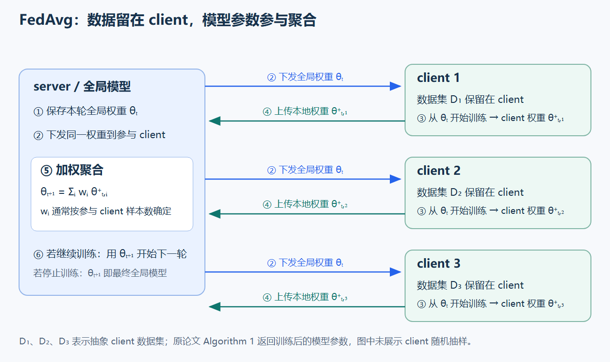
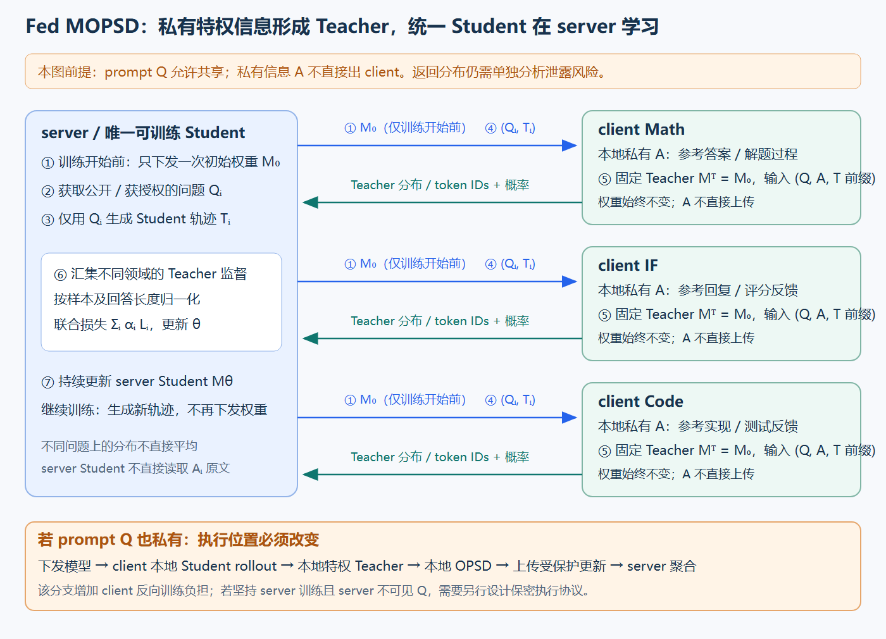

# FedAvg、FedTOPS 到 Fed MOPSD：一种基于特权信息的联邦蒸馏思路

## 1. 传统 FedAvg 到联邦蒸馏

### 1.1 传统 FedAvg 是怎样做的？

传统联邦学习的基本出发点是：训练数据分散在不同 client 上，client 不能把原始数据直接交给 server，但多个 client 仍希望共同训练出一个全局模型。

设 server 在第 $t$ 轮维护全局模型权重 $M_t$ ，client $i$ 持有数据集 $\mathcal D_i$ 。根据 FedAvg 原论文的 Algorithm 1，一轮通信包含以下过程：

1. server 把同一份模型权重 $M_t$ 发给本轮参与训练的 client。
2. 每个 client 以 $M_t$ 为起点，在自己的数据 $\mathcal D_i$ 上训练，得到更新后的模型 $M_{t,i}$。
3. client 把训练后的模型参数传回 server，原始训练数据不参与该次通信。
4. server 按 client 样本量进行加权平均，得到新的全局模型 $M_{t+1}$ 。至此，第 $t$ 轮通信结束。

FedAvg 原文描述的是多轮训练算法，而不是只聚合一次的 one-shot 方法。只有在尚未达到停止条件时，server 才会在下一轮把 $M_{t+1}$ 发给新一轮选中的 client；如果训练在本轮结束，则 $M_{t+1}$ 就是最终全局模型。因此，“再次下发”属于下一轮训练，不是本轮加权平均之后必然执行的额外步骤。

若 client $i$ 的样本量为 $n_i$ ，本轮参与 client 集合为 $\mathcal S_t$ ，则聚合过程可以写为：

$$
w_i=\frac{n_i}{\sum_{r\in\mathcal S_t}n_r},
\qquad
\theta_{t+1}=\sum_{i\in\mathcal S_t}w_i\theta_{t,i}.
$$

*图 1：FedAvg 的一轮通信。server 加权平均后得到新的全局模型；只有继续训练时，才将它用于下一轮。*

FedAvg 在参数空间进行聚合。当 client 数据非独立同分布、并且各 client 执行多步训练时，client 更新可能产生偏移；参数平均后的模型也不保证在每个 client 任务上都优于相应 client 模型。这里是在说明 FedAvg 可能遇到的问题，并不是说原论文证明了参数平均必然导致能力下降。

### 1.2 不上传完整模型，还可以怎样传递知识？

client 不一定要把完整模型权重传回 server，也可以通过预测结果或概率分布来传递知识。

1. **FedMD: Heterogenous Federated Learning via Model Distillation（通过模型蒸馏实现的异构联邦学习）[2]。** FedMD 先让各 client 分别在公共数据和私有数据上训练自己的模型；在每轮协作中，各 client 计算公共样本上的 class scores 并发送给 server。server 对这些分数求平均形成 consensus，再把 consensus 发回各 client。各 client 先在公共数据上学习 consensus，然后再次在自己的私有数据上训练。由于交换的是公共样本上的模型输出，各 client 可以使用不同结构的模型。

2. **Federated Mutual Knowledge Transfer（FedMKT，联邦相互知识迁移）[4]。** FedMKT 在 server 部署 LLM、在 client 部署 SLM。每个 client 先使用自己的私有数据集对 SLM 进行微调。然后 client 和 server 在共享公共数据集上交换 loss-logit pairs：loss 用于判断发送方知识是否优于接收方，筛选出的 logits 用于蒸馏接收方模型。该过程支持 client 到 server 和 server 到 client 的双向知识传递；tokenizer 不同时，先使用基于最小编辑距离的 token alignment 对齐输出。

联邦学习中传递的不一定是完整权重，也可以是模型在某些输入上的输出分布。不过，logits 的通信开销并不一定小。

## 2. FedOPD 与 FedTOPS

*Trapped by Their Own Rollouts: Understanding Aggregation–Rollout Feedback in Federated On-Policy Distillation*（《受困于自身生成轨迹：理解联邦在线策略蒸馏中的聚合—轨迹反馈》）[5]。提出 Federated Teacher-guided On-Policy Scaling，简称 FedTOPS（联邦教师引导的在线策略缩放）。

FedOPD 沿用 FedAvg 的基本结构：server 向各 client 下发当前全局 Student 参数 $\theta_t$；各 client 完成本地 OPD 后上传更新参数 $\theta^+_{t,i}$；server 按 client 权重 $w_i$ 进行加权平均：

$$
\bar\theta_t=\sum_i w_i\theta^+_{t,i},
\qquad
\theta_{t+1}=\bar\theta_t.
$$

FedAvg 到这里就完成了本轮聚合。

Federated Teacher-guided On-Policy Scaling（FedTOPS）与 FedAvg 最主要的区别，是在 server 聚合时加入可控倍率 $a$。server 先计算普通 FedAvg 的聚合增量：

$$
\Delta_t=\bar\theta_t-\theta_t.
$$

然后保持更新方向不变，用不同的 $a$ 构造候选模型：

$$
\theta_t(a)=\theta_t+a\Delta_t,
\qquad
a\in\{0.5,1,2,3,5,10\}.
$$

其流程为：

1. client 训练和参数上传方式与 FedAvg 相同；
2. server 先得到 FedAvg 聚合结果 $\bar\theta_t$ 和聚合增量 $\Delta_t$；
3. server 用多个 $a$ 构造候选模型，并复用本轮缓存进行评估；
4. 在各 client 预测变化满足约束的候选中，选择与 Teacher 分布最接近的倍率 $a_t$；
5. server 输出 $$\theta_{t+1}=\theta_t+a_t\Delta_t.$$

其中， $a=1$ 的候选等于普通 FedAvg 结果， $a>1$ 放大本轮聚合更新， $a<1$ 缩小本轮聚合更新；若没有候选满足约束，则取 $a_t=0$ ，保留本轮起始模型。FedTOPS 不改变 client 的 OPD 训练方式和学习率，只在 server 端控制最终采用多大的聚合步幅。

*图 2：上半部分为 FedAvg，server 加权平均后直接结束本轮聚合；下半部分为 FedTOPS，server 在相同聚合方向上用倍率 $a$ 构造候选，并选择最终更新步幅。*

FedTOPS 对 $a$ 的选择分为两步。这里用 $p_\theta$ 表示参数为 $\theta$ 的同一个 Student 所产生的输出分布，用 $q$ 表示固定 Teacher 在相同缓存 prefix 上给出的输出分布；$\widetilde p_\theta$ 和 $\widetilde q$ 中的波浪号表示相应分布经过相同的词表压缩。首先，对每个候选模型 $\theta_t(a)=\theta_t+a\Delta_t$ ，分别检查它在各 client 上相对于本轮起始 Student 的预测变化：

$$
\widehat K_{i,t}(a)
=\widehat{\mathbb E}_{i,t}
D_{\mathrm{KL}}\!\left(
\widetilde p_{\theta_t}\,\|\,\widetilde p_{\theta_t+a\Delta_t}
\right).
$$

只有对所有 client 都满足

$$
\widehat K_{i,t}(a)\leq\delta
$$

的候选才是可行候选。论文实验统一取 $\delta=0.05$ ，该约束用于防止放大聚合增量后模型预测变化过大。

然后，server 在可行候选中计算候选 Student 与 Teacher 分布之间的加权差异：

$$
\widehat J_t(a)
=\sum_i w_i\widehat{\mathbb E}_{i,t}
D_{\mathrm{KL}}\!\left(
\widetilde q\,\|\,\widetilde p_{\theta_t+a\Delta_t}
\right),
$$

并选择 Teacher 差异最小的倍率：

$$
a_t
=\arg\min_a\widehat J_t(a),
\qquad
\text{s.t. }\widehat K_{i,t}(a)\leq\delta,\ \forall i.
$$

这些分数复用本轮本地优化前缓存的轨迹计算，不会为了选择 $a$ 重新生成 rollout。论文在每个 client 缓存 4 条训练回答，每条最多选取 16 个预测位置；在每个位置，将 Teacher top-16 与起始 Student top-16 的 token ID 取并集，其余词表概率合并为一个 tail bucket，再在该压缩分布上计算上述 KL。若 $a=1$ 可行，则以普通 FedAvg 结果作为默认候选，只有 Teacher 分数严格更低的可行候选才会替换它；若不存在任何可行候选，则令 $a_t=0$。

## 3. Fed MOPSD：client 保留特权信息，server 训练统一 Student

### 3.1 从 MOPD 与 OPSD 得到 Fed MOPSD

OPSD[7] 的思想是：Teacher 和 Student 是同一个参数化模型 $p_\theta$ 在两种不同上下文下形成的条件分布。

- Student 只能看到问题 $Q$；
- Teacher 可以额外看到训练时的特权信息 $A$；
- Student 先在 $Q$ 上生成自己的轨迹 $T$；
- Teacher 读取 $Q+A$，并在 Student 的轨迹上逐 token 给出分布；
- 计算当前训练步的损失时，梯度只通过 Student logits，Teacher 分布作为 stop-gradient target。

在本文提出的 Fed MOPSD 中，这一思想被实现为长期固定的 client Teacher：训练开始前，server 只下发一次初始模型；client 冻结该副本，此后不再接收 server 更新后的 Student 权重。server Student 可以持续更新并生成新的轨迹，但 client Teacher 的权重在整个训练过程中保持不变。

### 3.2 我们的 Fed MOPSD 流程

client $i$ 持有 $N_i$ 条私有训练样本，每条样本由 prompt $Q$ 和特权信息 $A$ 组成：

$$
\mathcal{D}_i=\lbrace(Q_{i,j},A_{i,j})\rbrace_{j=1}^{N_i}
$$

训练开始前，server 只向各 client 下发一次初始模型 $M_0$。每个 client 将收到的副本永久冻结，记为 $M^{\mathrm T}=M_0$ ；server 则保留一个从 $M_0$ 初始化、可以持续更新的 Student $M_\theta$ 。对于第 $j$ 条样本以及 Student 轨迹 $T_{i,j}$ 的第 $k$ 个 token 位置，Teacher 分布为：

$$
q_{i,j,k}
=M^{\mathrm{T}}\left(\cdot\mid Q_{i,j},A_{i,j},T_{i,j,\lt k}\right)
$$

server 上可训练 Student 的分布为：

$$
p_{\theta,i,j,k}
=M_\theta\left(\cdot\mid Q_{i,j},T_{i,j,\lt k}\right)
$$

这里的 $\cdot$ 表示完整的下一 token 概率分布。两者处理同一个轨迹前缀 $T_{i,j,<k}$ ，区别是 Teacher 能看到 $Q_{i,j}+A_{i,j}$ ，Student 只能看到 $Q_{i,j}$ 。Teacher 使用固定的 $M^{\mathrm T}$ ，不参与反向传播；梯度只更新 server 上的 $M_\theta$ 。随着 Student 更新，轨迹前缀可能变化，因此 Teacher 的输出分布也可能随输入轨迹变化，但 Teacher 权重始终不变。

以下内容是本文提出的 Fed MOPSD 流程，不是 FedOPD、MOPD 或 OPSD 原文已经给出的算法。这里首先限定场景：prompt 可以共享，只有特权信息 $A$ 不直接发送给 server。

1. **server 一次性下发初始模型。** 训练开始前，server 把初始 Student 权重 $M_0$ 发送给各 client。client 将其冻结为整个训练期间固定的 Teacher $M^{\mathrm T}$ ，后续不再接收更新后的 Student 权重。
2. **server 获得 prompt。** client 向 server 提供本轮使用的 prompt 集合 $Q_i$ ，或者 server 根据 client 领域提供一组公共 prompt。这里必须明确：这些 prompt 是允许 server 获得的。
3. **server 生成轨迹。** server 使用当前 Student，根据 $Q_{i,j}$ 生成轨迹 $T_{i,j}$ 。
4. **server 发送轨迹。** server 把 $(Q_{i,j},T_{i,j})$ 发送给对应 client。
5. **client 构造特权 Teacher。** client 找到与 $Q_{i,j}$ 对应的特权信息 $A_{i,j}$ ，让冻结模型读取 $Q_{i,j}+A_{i,j}$ ，并在轨迹 $T_{i,j}$ 的每个 token 位置给出 Teacher 分布。
6. **client 返回分布。** client 把 Teacher 分布（logits）或压缩后的 top-$k$ 结果发送给 server。
7. **server 更新 Student。** server 使用来自不同 client 的 Teacher 分布训练同一个 Student。
8. **继续训练或结束。** 如果训练继续，server 使用更新后的 Student 生成下一批轨迹，并重复步骤 2—7；各 client 始终使用最初冻结的 $M^{\mathrm T}$，server 不再下发新的模型权重。达到停止条件后，server Student 即为最终模型。

*图 4：训练开始前，server 只下发一次初始模型；client 将其固定为 Teacher。训练期间只有 server Student 持续 rollout 和更新，client Teacher 不再同步新权重。图中流程成立的前提是 prompt 允许 server 获得。*

--------------------------------------------------

### Q1:当前架构的合理性？

- 创新的前提

**这个方案只是简单的 Fed + MOPD + OPSD 套在一起。还需要创新点和其他工作量**

### Q2：显存问题

**各个client的数据是私有的，它们之间是独立的，所以每个client要独自维护一个初始模型。**

**初始模型选择Qwen3-4B**

如果有 Math、IF、Code 三个 client，逻辑上需要维护：

- server 上的 1 个可训练 Student；
- 每个 client 上的 1 个冻结模型，用于结合特权信息产生 Teacher 分布。
（4x8GB = 32GB）

--------------------------------------------------

--------------------------------------------------

## 参考文献

1. McMahan et al. **Communication-Efficient Learning of Deep Networks from Decentralized Data.** AISTATS 2017。[论文链接](https://proceedings.mlr.press/v54/mcmahan17a.html)
2. Li and Wang. **FedMD: Heterogenous Federated Learning via Model Distillation.** 2019。[论文链接](https://arxiv.org/abs/1910.03581)
3. Lin et al. **Ensemble Distillation for Robust Model Fusion in Federated Learning.** NeurIPS 2020。[论文链接](https://papers.neurips.cc/paper/2020/hash/18df51b97ccd68128e994804f3eccc87-Abstract.html)
4. Fan et al. **FedMKT: Federated Mutual Knowledge Transfer for Large and Small Language Models.** COLING 2025。[论文链接](https://aclanthology.org/2025.coling-main.17/)
5. Chen, Zhu, and Liu. **Trapped by Their Own Rollouts: Understanding Aggregation–Rollout Feedback in Federated On-Policy Distillation.** 2026。[论文链接](https://arxiv.org/abs/2609.32573)；[fed opd.pdf](../references/fed%20opd.pdf)
6. Ma et al. **MOPD: Multi-Teacher On-Policy Distillation for Capability Integration in LLM Post-Training.** 2026。[论文链接](https://arxiv.org/abs/2606.30406)；[MOPD.pdf](../references/MOPD.pdf)
7. Zhao et al. **Self-Distilled Reasoner: On-Policy Self-Distillation for Large Language Models.** 2026。[论文链接](https://arxiv.org/abs/2601.18734)；[OPSD.pdf](../references/OPSD.pdf)
