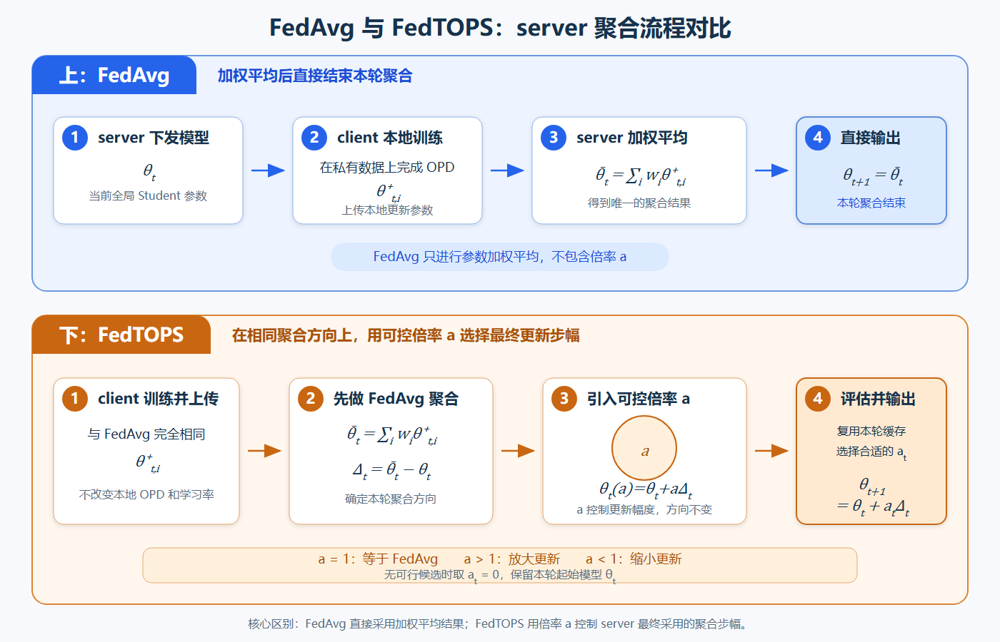

# FedAvg、FedTOPS 到 Fed MOPSD：一种基于特权信息的联邦蒸馏思路

## 1. 传统 FedAvg 到联邦蒸馏

### 1.1 传统 FedAvg 是怎样做的？

传统联邦学习的基本出发点是：训练数据分散在不同 client 上，client 不能把原始数据直接交给 server，但多个 client 仍希望共同训练出一个全局模型。

设 server 在第 $t$ 轮维护全局模型权重 $M_t$ ，client $i$ 持有数据集 $\mathcal D_i$ 。根据 FedAvg 原论文的 Algorithm 1，一轮通信包含以下过程：

1. server 把同一份模型权重 $M_t$ 发给本轮参与训练的 client。
2. 每个 client 以 $M_t$ 为起点，在自己的数据 $\mathcal D_i$ 上训练，得到更新后的模型 $M_{t,i}$。
3. client 把训练后的模型参数传回 server，原始训练数据不参与该次通信。
4. server 按 client 样本量进行加权平均，得到新的全局模型 $M_{t+1}$ 。至此，第 $t$ 轮通信结束。

FedAvg 原文描述的是多轮训练算法，而不是只聚合一次的 one-shot 方法。只有在尚未达到停止条件时，server 才会在下一轮把 $M_{t+1}$ 发给新一轮选中的 client；如果训练在本轮结束，则 $M_{t+1}$ 就是最终全局模型。因此，“再次下发”属于下一轮训练，不是本轮加权平均之后必然执行的额外步骤。

若 client $i$ 的样本量为 $n_i$ ，本轮参与 client 集合为 $\mathcal S_t$ ，则聚合过程可以写为：

$$
w_i=\frac{n_i}{\sum_{r\in\mathcal S_t}n_r},
\qquad
\theta_{t+1}=\sum_{i\in\mathcal S_t}w_i\theta_{t,i}.
$$

*图 1：FedAvg 的一轮通信。server 加权平均后得到新的全局模型；只有继续训练时，才将它用于下一轮。*

FedAvg 在参数空间进行聚合。当 client 数据非独立同分布、并且各 client 执行多步训练时，client 更新可能产生偏移；参数平均后的模型也不保证在每个 client 任务上都优于相应 client 模型。这里是在说明 FedAvg 可能遇到的问题，并不是说原论文证明了参数平均必然导致能力下降。

### 1.2 不上传完整模型，还可以怎样传递知识？

client 不一定要把完整模型权重传回 server，也可以通过预测结果或概率分布来传递知识。

1. **FedMD: Heterogenous Federated Learning via Model Distillation（通过模型蒸馏实现的异构联邦学习）[2]。** FedMD 先让各 client 分别在公共数据和私有数据上训练自己的模型；在每轮协作中，各 client 计算公共样本上的 class scores 并发送给 server。server 对这些分数求平均形成 consensus，再把 consensus 发回各 client。各 client 先在公共数据上学习 consensus，然后再次在自己的私有数据上训练。由于交换的是公共样本上的模型输出，各 client 可以使用不同结构的模型。

2. **Federated Mutual Knowledge Transfer（FedMKT，联邦相互知识迁移）[4]。** FedMKT 在 server 部署 LLM、在 client 部署 SLM。每个 client 先使用自己的私有数据集对 SLM 进行微调。然后 client 和 server 在共享公共数据集上交换 loss-logit pairs：loss 用于判断发送方知识是否优于接收方，筛选出的 logits 用于蒸馏接收方模型。该过程支持 client 到 server 和 server 到 client 的双向知识传递；tokenizer 不同时，先使用基于最小编辑距离的 token alignment 对齐输出。

联邦学习中传递的不一定是完整权重，也可以是模型在某些输入上的输出分布。不过，logits 的通信开销并不一定小。

## 2. FedOPD 与 FedTOPS

*Trapped by Their Own Rollouts: Understanding Aggregation–Rollout Feedback in Federated On-Policy Distillation*（《受困于自身生成轨迹：理解联邦在线策略蒸馏中的聚合—轨迹反馈》）[5]。提出 Federated Teacher-guided On-Policy Scaling，简称 FedTOPS（联邦教师引导的在线策略缩放）。

FedOPD 沿用 FedAvg 的基本结构：server 向各 client 下发当前全局 Student 参数 $\theta_t$；各 client 完成本地 OPD 后上传更新参数 $\theta^+_{t,i}$；server 按 client 权重 $w_i$ 进行加权平均：

$$
\bar\theta_t=\sum_i w_i\theta^+_{t,i},
\qquad
\theta_{t+1}=\bar\theta_t.
$$

FedAvg 到这里就完成了本轮聚合。

Federated Teacher-guided On-Policy Scaling（FedTOPS）与 FedAvg 最主要的区别，是在 server 聚合时加入可控倍率 $a$。server 先计算普通 FedAvg 的聚合增量：

$$
\Delta_t=\bar\theta_t-\theta_t.
$$

然后保持更新方向不变，用不同的 $a$ 构造候选模型：

$$
\theta_t(a)=\theta_t+a\Delta_t,
\qquad
a\in\{0.5,1,2,3,5,10\}.
$$

其流程为：

1. client 训练和参数上传方式与 FedAvg 相同；
2. server 先得到 FedAvg 聚合结果 $\bar\theta_t$ 和聚合增量 $\Delta_t$；
3. server 用多个 $a$ 构造候选模型，并复用本轮缓存进行评估；
4. 在各 client 预测变化满足约束的候选中，选择与 Teacher 分布最接近的倍率 $a_t$；
5. server 输出 $$\theta_{t+1}=\theta_t+a_t\Delta_t.$$

其中， $a=1$ 的候选等于普通 FedAvg 结果， $a>1$ 放大本轮聚合更新， $a<1$ 缩小本轮聚合更新；若没有候选满足约束，则取 $a_t=0$ ，保留本轮起始模型。FedTOPS 不改变 client 的 OPD 训练方式和学习率，只在 server 端控制最终采用多大的聚合步幅。

*图 2：上半部分为 FedAvg，server 加权平均后直接结束本轮聚合；下半部分为 FedTOPS，server 在相同聚合方向上用倍率 $a$ 构造候选，并选择最终更新步幅。*

FedTOPS 对 $a$ 的选择分为两步。这里用 $p_\theta$ 表示参数为 $\theta$ 的同一个 Student 所产生的输出分布，用 $q$ 表示固定 Teacher 在相同缓存 prefix 上给出的输出分布；$\widetilde p_\theta$ 和 $\widetilde q$ 中的波浪号表示相应分布经过相同的词表压缩。首先，对每个候选模型 $\theta_t(a)=\theta_t+a\Delta_t$ ，分别检查它在各 client 上相对于本轮起始 Student 的预测变化：

$$
\widehat K_{i,t}(a)
=\widehat{\mathbb E}_{i,t}
D_{\mathrm{KL}}\!\left(
\widetilde p_{\theta_t}\,\|\,\widetilde p_{\theta_t+a\Delta_t}
\right).
$$

只有对所有 client 都满足

$$
\widehat K_{i,t}(a)\leq\delta
$$

的候选才是可行候选。论文实验统一取 $\delta=0.05$ ，该约束用于防止放大聚合增量后模型预测变化过大。

然后，server 在可行候选中计算候选 Student 与 Teacher 分布之间的加权差异：

$$
\widehat J_t(a)
=\sum_i w_i\widehat{\mathbb E}_{i,t}
D_{\mathrm{KL}}\!\left(
\widetilde q\,\|\,\widetilde p_{\theta_t+a\Delta_t}
\right),
$$

并选择 Teacher 差异最小的倍率：

$$
a_t
=\arg\min_a\widehat J_t(a),
\qquad
\text{s.t. }\widehat K_{i,t}(a)\leq\delta,\ \forall i.
$$

这些分数复用本轮本地优化前缓存的轨迹计算，不会为了选择 $a$ 重新生成 rollout。论文在每个 client 缓存 4 条训练回答，每条最多选取 16 个预测位置；在每个位置，将 Teacher top-16 与起始 Student top-16 的 token ID 取并集，其余词表概率合并为一个 tail bucket，再在该压缩分布上计算上述 KL。若 $a=1$ 可行，则以普通 FedAvg 结果作为默认候选，只有 Teacher 分数严格更低的可行候选才会替换它；若不存在任何可行候选，则令 $a_t=0$。

## 3. Fed MOPSD：client 保留特权信息，server 训练统一 Student

### 3.1 从 MOPD 与 OPSD 得到 Fed MOPSD

OPSD[7] 的思想是：Teacher 和 Student 是同一个参数化模型 $p_\theta$ 在两种不同上下文下形成的条件分布。

- Student 只能看到问题 $Q$；
- Teacher 可以额外看到训练时的特权信息 $A$；
- Student 先在 $Q$ 上生成自己的轨迹 $T$；
- Teacher 读取 $Q+A$，并在 Student 的轨迹上逐 token 给出分布；
- 计算当前训练步的损失时，梯度只通过 Student logits，Teacher 分布作为 stop-gradient target。

在本文提出的 Fed MOPSD 中，这一思想被实现为长期固定的 client Teacher：训练开始前，server 只下发一次初始模型；client 冻结该副本，此后不再接收 server 更新后的 Student 权重。server Student 可以持续更新并生成新的轨迹，但 client Teacher 的权重在整个训练过程中保持不变。

### 3.2 我们的 Fed MOPSD 流程

client $i$ 持有 $N_i$ 条私有训练样本，每条样本由 prompt $Q$ 和特权信息 $A$ 组成：

$$
\mathcal{D}_i=\lbrace(Q_{i,j},A_{i,j})\rbrace_{j=1}^{N_i}
$$

训练开始前，server 只向各 client 下发一次初始模型 $M_0$。每个 client 将收到的副本永久冻结，记为 $M^{\mathrm T}=M_0$ ；server 则保留一个从 $M_0$ 初始化、可以持续更新的 Student $M_\theta$ 。对于第 $j$ 条样本以及 Student 轨迹 $T_{i,j}$ 的第 $k$ 个 token 位置，Teacher 分布为：

$$
q_{i,j,k}
=M^{\mathrm{T}}\left(\cdot\mid Q_{i,j},A_{i,j},T_{i,j,\lt k}\right)
$$

server 上可训练 Student 的分布为：

$$
p_{\theta,i,j,k}
=M_\theta\left(\cdot\mid Q_{i,j},T_{i,j,\lt k}\right)
$$

这里的 $\cdot$ 表示完整的下一 token 概率分布。两者处理同一个轨迹前缀 $T_{i,j,<k}$ ，区别是 Teacher 能看到 $Q_{i,j}+A_{i,j}$ ，Student 只能看到 $Q_{i,j}$ 。Teacher 使用固定的 $M^{\mathrm T}$ ，不参与反向传播；梯度只更新 server 上的 $M_\theta$ 。随着 Student 更新，轨迹前缀可能变化，因此 Teacher 的输出分布也可能随输入轨迹变化，但 Teacher 权重始终不变。

以下内容是本文提出的 Fed MOPSD 流程，不是 FedOPD、MOPD 或 OPSD 原文已经给出的算法。这里首先限定场景：prompt 可以共享，只有特权信息 $A$ 不直接发送给 server。

1. **server 一次性下发初始模型。** 训练开始前，server 把初始 Student 权重 $M_0$ 发送给各 client。client 将其冻结为整个训练期间固定的 Teacher $M^{\mathrm T}$ ，后续不再接收更新后的 Student 权重。
2. **server 获得 prompt。** client 向 server 提供本轮使用的 prompt 集合 $Q_i$ ，或者 server 根据 client 领域提供一组公共 prompt。这里必须明确：这些 prompt 是允许 server 获得的。
3. **server 生成轨迹。** server 使用当前 Student，根据 $Q_{i,j}$ 生成轨迹 $T_{i,j}$ 。
4. **server 发送轨迹。** server 把 $(Q_{i,j},T_{i,j})$ 发送给对应 client。
5. **client 构造特权 Teacher。** client 找到与 $Q_{i,j}$ 对应的特权信息 $A_{i,j}$ ，让冻结模型读取 $Q_{i,j}+A_{i,j}$ ，并在轨迹 $T_{i,j}$ 的每个 token 位置给出 Teacher 分布。
6. **client 返回分布。** client 把 Teacher 分布（logits）或压缩后的 top-$k$ 结果发送给 server。
7. **server 更新 Student。** server 使用来自不同 client 的 Teacher 分布训练同一个 Student。
8. **继续训练或结束。** 如果训练继续，server 使用更新后的 Student 生成下一批轨迹，并重复步骤 2—7；各 client 始终使用最初冻结的 $M^{\mathrm T}$，server 不再下发新的模型权重。达到停止条件后，server Student 即为最终模型。

*图 4：训练开始前，server 只下发一次初始模型；client 将其固定为 Teacher。训练期间只有 server Student 持续 rollout 和更新，client Teacher 不再同步新权重。图中流程成立的前提是 prompt 允许 server 获得。*

如果有 Math、IF、Code 三个 client，逻辑上需要维护：

- server 上的 1 个可训练 Student；
- 每个 client 上的 1 个冻结模型，用于结合特权信息产生 Teacher 分布。
（4x8GB = 32GB）

**这个方案只是把MOPD、OPSD、Fed的思想结合在一起。我认为创新点最可能出现在第7步中：如何利用各client教师给出的信息？**

--------------------------------------------------

## 下面是大模型给的一些建议 （GPT）

### server 怎样吸收三个 client 的知识？（GPT）

对于 Math、IF、Code 三个 client，它们通常处理的是不同 prompt。不同问题上的 token 分布不能直接按词表位置求平均。例如，Math Teacher 对一道数学题给出的分布，与 Code Teacher 对一道编程题给出的分布没有直接平均的意义。

更合适的做法是分别计算各领域损失，再组成一个联合目标：

$$
\mathcal L(\theta)=\sum_i\alpha_i\mathcal L_i(\theta),
\qquad
\alpha_i\geq0,
\qquad
\sum_i\alpha_i=1,
$$

其中：

$$
\mathcal L_i(\theta)
=\frac{1}{|\mathcal B_i|}
\sum_{j\in\mathcal B_i}
\frac{1}{|T_{i,j}|}
\sum_{k=1}^{|T_{i,j}|}
D_{\mathrm{KL}}\!\left(
q_{i,j,k}\,\|\,p_{\theta,i,j,k}
\right).
$$

$\alpha_i$ 控制不同领域在训练中的权重。为了避免 Code 因回答更长而自然占据更大的损失比例，可以先在每条回答内部按 token 数归一化，再在领域内部按样本数归一化，最后使用 $\alpha_i$ 组合三个领域。

只有当多个 client 对完全相同的 $Q$ 和 $T_{<k}$ 都给出 Teacher 分布时，才可以讨论分布合并。记 client $i$ 的固定 Teacher 在共同 prefix $h$ 上给出的分布为 $q_i(v\mid h)$ ，则：

$$
\bar q(v\mid h)=\sum_i\beta_i(h)q_i(v\mid h),
\qquad
\sum_i\beta_i(h)=1.
$$

对于当前 Math、IF、Code 各自拥有不同训练数据的设定，本文建议把各领域样本的蒸馏损失组成联合目标，而不是对不同输入上的三个分布直接求平均。这是 Fed MOPSD 的设计选择，不是 OPSD 或 MOPD 原文结论。

另一种实现是让 client 依次工作，例如 Math $\rightarrow$ IF $\rightarrow$ Code，再回到 Math。这样可以减少并发活动模型的数量，但顺序训练可能产生顺序效应或领域遗忘。随机交错不同领域样本是一个可比较的候选实现，哪一种更好需要在相同样本量和更新步数下做消融，本文不预设结论。

### 3.4 逐 token 分布、top-$k$ 与通信开销 （GPT）

如果 client 返回完整词表分布，设一个训练批次共有 $B$ 条轨迹，平均轨迹长度为 $L$，词表大小为 $V$，那么该批次的上行通信量约为：

$$
O(BLV).
$$

这可能非常大。若每个 token 只返回 top-$k$ 的 token ID 和概率，通信量可以降为：

$$
O(BLk).
$$

但是，top-$k$ 不是完整分布，不能直接声称它与全词表 KL 完全相同。本文可以研究同时返回 top-$k$ token 概率和剩余总概率质量的 top-$k$ 加 tail 压缩，但这不是 OPSD 原文算法。FedTOPS 的 tail bucket 用于候选评分；MOPD 的 top-$k$ distillation 则在截断 reverse-KL 中加入修正项，二者也不能直接当成同一种损失。Fed MOPSD 需要分别比较：

- 完整词表分布；
- top-$k$ 加 tail；
- 只使用 sampled token；
- 不同 $k$ 值下的效果、通信量和训练时间。

如果 Fed MOPSD 采用 OPSD 原文表现最好的 full-vocabulary forward KL 配置，还应单独验证原文的 per-token pointwise clipping。对第 $n$ 个生成位置、词表项 $v$ 的 divergence contribution $\ell_{n,v}^{(f)}$，原文使用 $\min(\ell_{n,v}^{(f)},\tau)$ 后再对位置和词表求和。它截断的是每个位置、每个词表项的散度贡献，不是整条回答的总损失，也不是最大生成长度。OPSD 的消融显示 clipping 能稳定其数学实验，但这不能代替在 Math、IF、Code 联合训练中的重新验证。

### 3.5 prompt 是否也属于隐私？ （GPT）

这是 Fed MOPSD 中必须明确的问题。

在很多真实场景中，prompt 本身就可能包含用户身份、病情、内部代码、业务需求或未公开任务。因此，不能默认只有答案 $A$ 是隐私，而问题 $Q$ 一定可以上传。

本文上述 server rollout 流程成立，需要满足以下前提之一：

- prompt 来自公开数据集；
- prompt 由 server 提供；
- client 已经允许 server 使用这些 prompt；
- 研究场景明确规定只把特权信息 $A$ 视为不能泄露的数据。

在这个前提下，可以准确地表述为：client 不直接发送特权信息 $A$，server 只获得 prompt、Student 轨迹以及由 $A$ 影响的 Teacher 分布。不能进一步表述为“client 的完整训练数据 $(Q,A)$ 都不会离开 client”，因为 server 已经获得了 $Q$ 。

如果 prompt 和特权信息都需要保密，那么 server 不能直接生成依赖 $Q$ 的轨迹。流程需要改为：

1. server 向 client 发送当前模型权重；
2. client 在自己的 prompt 上完成 Student rollout；
3. client 在自己的 $(Q,A)$ 上构造 Teacher 分布；
4. client 直接完成 OPSD 更新；
5. client 上传参数增量或 LoRA 参数；
6. server 使用 FedAvg 或其他经过重新定义的聚合方法处理 client 更新。

这样就回到了“client OPSD + 联邦参数聚合”的路线，client 需要承担 Student 和 Teacher 的前向计算、Student 反向传播以及优化器状态，显存开销也会明显增加。FedTOPS 原文针对“共享固定 Teacher 下的本地 OPD + FedAvg 增量”设计；若把它用于这种 OPSD 场景，需要重新定义候选评分和 Teacher 条件，不能直接视为原算法已经覆盖。

还有一点需要注意：即使 client 没有直接发送 $A$ ，Teacher 分布仍然由 $A$ 决定，因此 logits 可能暴露一部分特权信息。Fed MOPSD 首先满足的是“特权信息原文不直接上传”，若要进一步给出严格的隐私保证，还需要研究分布压缩、噪声、差分隐私、安全聚合或保密计算等机制。

### 3.6 Fed MOPSD 与前面几种方法的区别 （GPT）

| 方法 | client 持有什么 | client 上传什么 | Student 在哪里更新 | server 怎样获得多 client 能力 |
|---|---|---|---|---|
| FedAvg | client 训练数据 | 训练后的模型参数 | client 训练，server 聚合 | 对 client 参数按样本量加权平均 |
| FedOPD + FedTOPS | client prompt、共享固定 Teacher | LoRA factors；附录 E.4 的分布式设想还可返回候选评分标量 | client 进行 OPD | server 沿 FedAvg 增量方向选择倍率 |
| 本文假设的分布式 MOPD | 已经训练好的领域 Teacher | 逐 token Teacher 分布或压缩信号 | server | Student 学习多个领域 Teacher 的输出 |
| Fed MOPSD | prompt 与特权信息，其中至少 $A$ 留在 client | 由特权信息产生的逐 token 分布 | server | 同一个 Student 联合学习各 client 的特权 Teacher 分布 |

Fed MOPSD 最关键的区别是：client 不必预先拥有一个额外的强 Teacher，也不必各自训练并上传完整 Student。server 下发的同一份模型在 client 被冻结，并因为看到了特权信息而成为 Teacher；server 上的 Student 只看普通输入，并学习多个 client 返回的逐 token 分布。

这一方案需要通过实验回答以下问题：

1. 特权信息是否真的能使同源 Teacher 比当前 Student 给出更有效的分布？
2. Math、IF、Code 三个领域联合训练时，怎样设置领域比例才能减少相互干扰？
3. OPSD 的逐 token clipping 在多领域训练中是否仍然有效？
4. 完整分布、top-$k$ 加 tail 和 sampled-token 的效果差距有多大？
5. 当 server Student 持续更新、与固定 Teacher 的参数差距逐渐增大时，训练是否仍然稳定？
6. 与“client 各自 OPSD 后使用 FedAvg”相比，server 统一蒸馏能否更好地保留各领域能力？
7. 在相同训练 token 数和推理预算下，效果提升是否足以抵消额外的 logits 通信开销？

从研究路线来看，可以先在 prompt 可共享、只有特权信息需要保留在 client 的设定下验证算法是否有效。第一阶段先比较以下基线：

- 初始 Student；
- 单领域 OPSD；
- 三个 client 分别 OPSD 后进行 FedAvg；
- 三个领域集中式 MOPD；
- 本文提出的 Fed MOPSD。

如果 Fed MOPSD 能够在相同训练预算下比 FedAvg 更稳定地保留 Math、IF、Code 三个领域能力，再进一步研究 top-$k$ 压缩、异步 client、client 采样以及更严格的隐私保护会更有意义。

## 参考文献

1. McMahan et al. **Communication-Efficient Learning of Deep Networks from Decentralized Data.** AISTATS 2017。[论文链接](https://proceedings.mlr.press/v54/mcmahan17a.html)
2. Li and Wang. **FedMD: Heterogenous Federated Learning via Model Distillation.** 2019。[论文链接](https://arxiv.org/abs/1910.03581)
3. Lin et al. **Ensemble Distillation for Robust Model Fusion in Federated Learning.** NeurIPS 2020。[论文链接](https://papers.neurips.cc/paper/2020/hash/18df51b97ccd68128e994804f3eccc87-Abstract.html)
4. Fan et al. **FedMKT: Federated Mutual Knowledge Transfer for Large and Small Language Models.** COLING 2025。[论文链接](https://aclanthology.org/2025.coling-main.17/)
5. Chen, Zhu, and Liu. **Trapped by Their Own Rollouts: Understanding Aggregation–Rollout Feedback in Federated On-Policy Distillation.** 2026。[论文链接](https://arxiv.org/abs/2609.32573)；[fed opd.pdf](../references/fed%20opd.pdf)
6. Ma et al. **MOPD: Multi-Teacher On-Policy Distillation for Capability Integration in LLM Post-Training.** 2026。[论文链接](https://arxiv.org/abs/2606.30406)；[MOPD.pdf](../references/MOPD.pdf)
7. Zhao et al. **Self-Distilled Reasoner: On-Policy Self-Distillation for Large Language Models.** 2026。[论文链接](https://arxiv.org/abs/2601.18734)；[OPSD.pdf](../references/OPSD.pdf)
